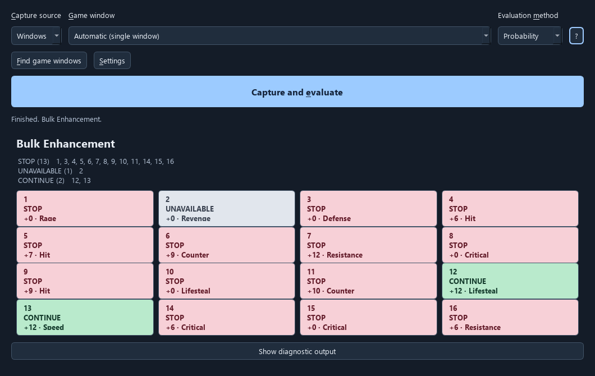
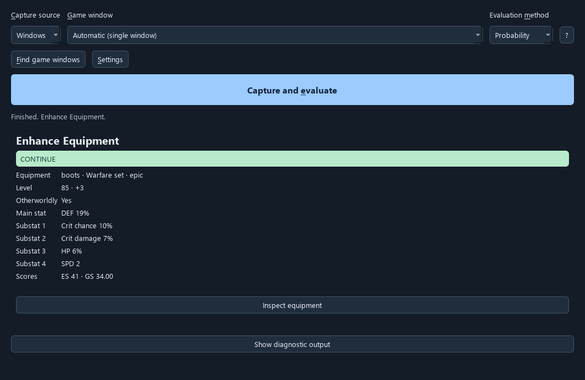
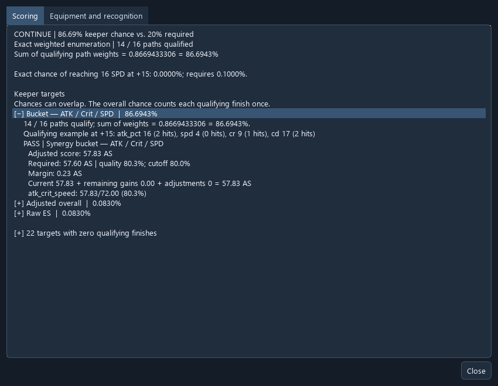
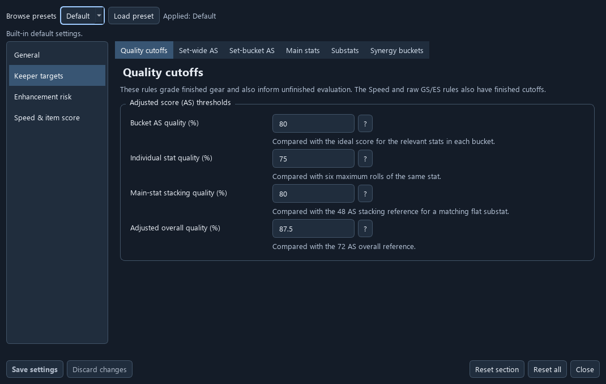

# E7 Enhancement Helper

A Windows desktop utility for evaluating equipment in **Epic Seven** using screenshot recognition.

E7 Equipment Helper reads equipment directly from the game and recommends whether to **CONTINUE, STOP, or KEEP** based on configurable evaluation rules. It is designed to simplify equipment enhancement decisions without requiring manual stat entry.

## Features

- **Bulk evaluation:** Recognizes and evaluates up to 16 equipment pieces simultaneously.
- **Multiple screens:** Supports bulk enhancement, equipment bag, and individual equipment detail screens.
- **Equipment scoring:** Calculates GS (Gear Score), recognizes in-game ES (Equipment Score) where available, and applies contextual AS (Adjusted Score).
- **Enhancement projections:** Evaluates current stats and maximum remaining enhancement potential.
- **Configurable rules:** Speed, individual-stat quality, stat synergy, main-stat stacking, overall quality, and GS/ES thresholds.
- **Advanced evaluation:** Supports set bonuses and penalties, modification recommendations, and borderline equipment.
- **Detailed results:** Provides scoring breakdowns explaining why equipment qualifies or fails.

## Screenshots

### Bulk Equipment Evaluation

### Single Equipment Evaluation

### Scoring Breakdown

### Settings

## Download and Installation

Download the latest Windows ZIP from **[GitHub Releases](../../releases/latest)**.

1. Extract the entire ZIP to a folder of your choice.
2. Run `E7EquipmentHelper.exe`.
3. Launch Epic Seven in **English**.

No separate Python installation is required. Keep the extracted application files together.

## Supported Platforms

| Platform | Capture | Supported resolution |
|---|---|---|
| LDPlayer / Android emulator | ADB | 1920×1080 |
| STOVE PC | Windows | 1920×1080, 2560×1440 |
| Steam PC | Windows | 1920×1080, 2560×1440 |

Steam support has received less testing than STOVE and LDPlayer.

For Windows capture, keep the game window visible and unobstructed. Emulator capture requires ADB access.

## How to Use

1. Open a supported equipment screen in Epic Seven.
2. Launch E7 Equipment Helper and select **Auto**, **ADB**, or **Windows** capture.
3. Keep the default evaluation settings or configure your own.
4. Click **Capture and evaluate**.
5. Review the recommendations and select an item to inspect its scoring breakdown.

The bulk enhancement screen displays results in a 4×4 grid matching the in-game equipment positions. Bag and detail screens evaluate the currently displayed item, not the entire inventory.

## Settings and Customization

E7 Equipment Helper includes **two default evaluation presets** as starting points for different equipment enhancement preferences.
1. Default
2. Strict

For most players, I recommend using one of the default presets and adjusting only:

- **Speed:** Set your preferred speed qualification and +15 keeper thresholds.
- **GS/ES Pass Rule:** Enable and configure minimum Gear Score or Equipment Score requirements at different enhancement stages.

Most other evaluation settings are also configurable, including individual-stat quality, stat synergy, overall quality thresholds, set-specific bonuses and penalties, modification recommendations, and borderline evaluations.

Advanced settings are available for players who want finer control over how equipment is evaluated. However, changing them is not necessary for normal use.

**Recommendations are based on your selected settings, not universal equipment standards.**

## Understanding Recommendations

| Result | Meaning |
|---|---|
| **CONTINUE** | Unfinished equipment passes at least one evaluation rule. |
| **STOP** | Equipment fails the configured qualification rules. |
| **STOP - BORDERLINE** | Equipment narrowly misses an eligible quality threshold. |
| **KEEP** | Fully enhanced equipment passes at least one rule. |
| **KEEP IF MODIFIED** | Equipment may qualify with a suitable stat modification. |
| **UNAVAILABLE / FAILED** | Equipment could not be reliably evaluated. |

Equipment only needs to pass one enabled qualification rule. Enhancement projections assume maximum possible future rolls rather than their probability.

**STOP does not necessarily mean an item is useless.** Recommendations depend on your configured criteria and do not account for your specific heroes or equipment inventory.

## Known Limitations

- Supports Lv85/88 Epic and Heroic equipment. Lv90 is recognized but evaluation is based on 85 gear. 
- Recognition requires supported resolutions, layouts, and English-language game text.
- Lv85 enhancement projections exclude reforge bonuses.
- Locked or unrecognized substats cannot contribute to evaluation.
- Modification recommendations are hypothetical and require manual verification.
- The evaluator does not optimize equipment allocation across heroes.

## Feedback and Bug Reports

Report bugs, recognition errors, or questionable recommendations through [GitHub Issues](../../issues).

When relevant, include the application version, capture platform, equipment screenshot, debug log, and a description of the problem.

Screenshots and debug logs are stored locally and are not automatically uploaded.

## Disclaimer

E7 Equipment Helper is an independent community project, unaffiliated with Smilegate or Super Creative.

The application uses screenshots only. It does not require account credentials, access game memory, or automate in-game equipment actions.

Recommendations are advisory, and compatibility with Epic Seven's terms of service is not guaranteed.
